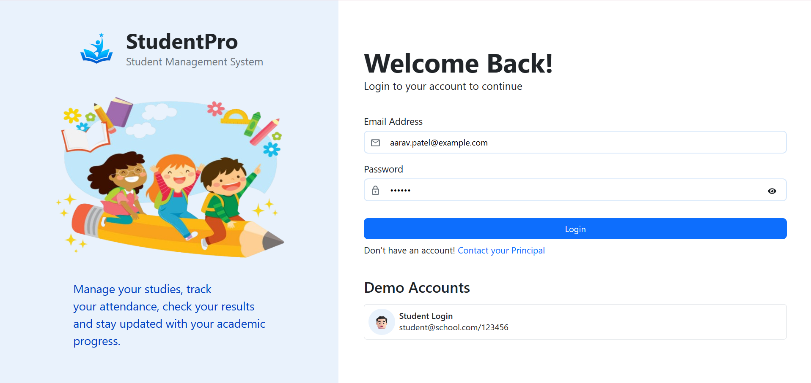
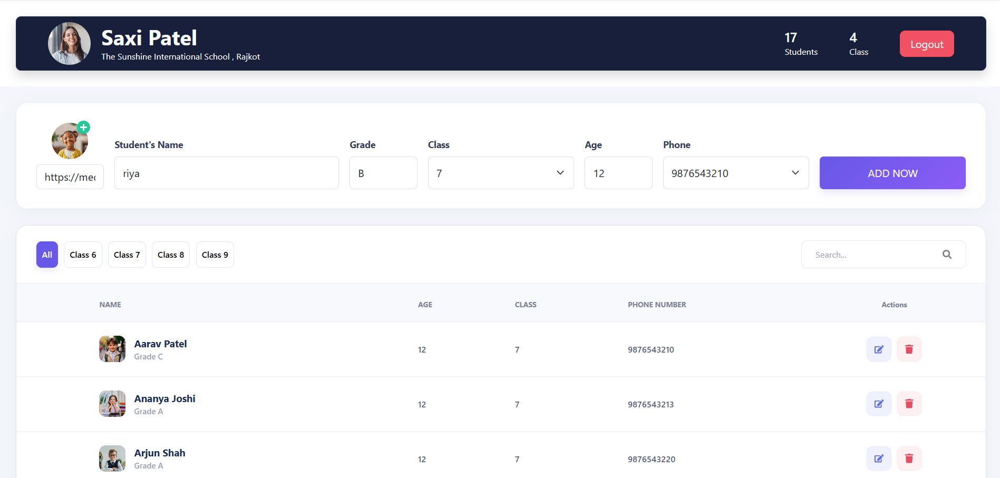
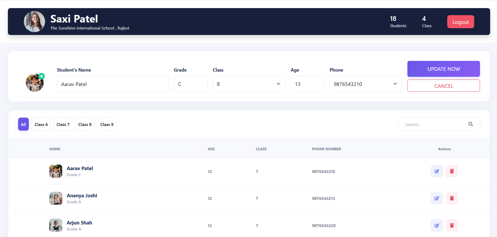
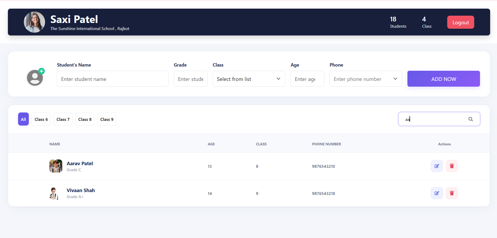
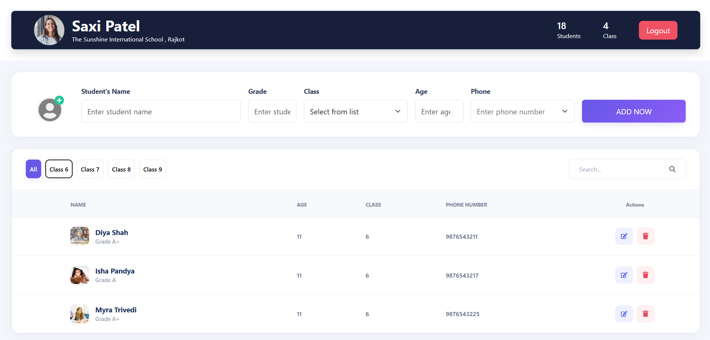
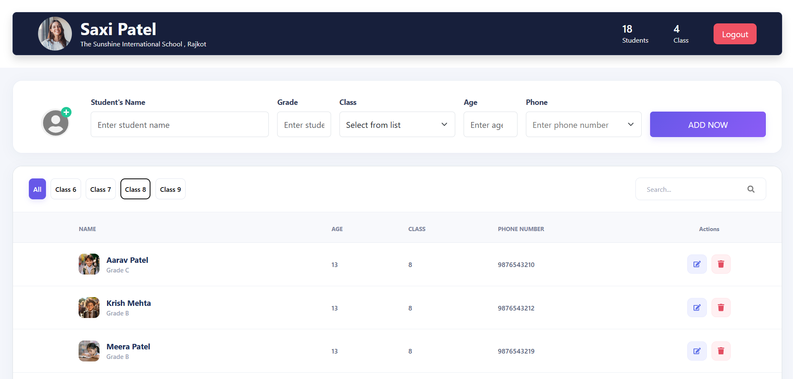
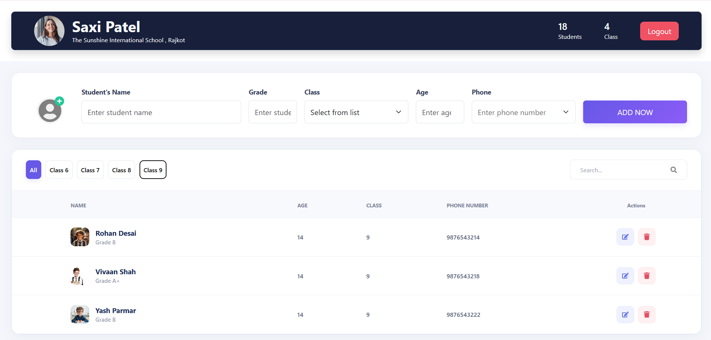

# 🎓 StudentPro – Student Management System

StudentPro is a **Student Management System** built using React, Redux, React Router, and JSON Server. It provides a simple and user-friendly interface to manage student records, including adding, editing, deleting, searching, and filtering students by class.

## ✨ Features

- 🔐 Login System
- 👨‍🎓 Add Students
- ✏️ Update Student Details
- 🗑️ Delete Students
- 🔍 Search Students
- 📚 Filter Students by Class
- 🔤 Sort Students Alphabetically
- 🖼️ Student Profile Images
- 📊 Dashboard Statistics
- 🔒 Protected Dashboard
- 📱 Responsive UI
- 🚪 Logout

## 🛠️ Technologies Used

- React.js
- Vite
- Redux
- React Redux
- React Router DOM
- Axios
- JSON
- Bootstrap
- CSS
- React Icons
- JavaScript

## 📂 Project Structure

- student-management-systeam(final-project)/
  - public/
  - src/
    - assets/
    - components/
      - Navbar.jsx
      - StudentForm.jsx
      - StudentList.jsx
      - StudentDetails.jsx
      - PrivateRoute.jsx
    - pages/
      - Login.jsx
      - Dashboard.jsx
    - redux/
      - action.js
      - reducer.js
      - store.js
    - screenshots
      - Screenshot1.png 
      - Screenshot2.png 
      - Screenshot3.png 
      - Screenshot4.png 
      - Screenshot5.png 
      - Screenshot6.png 
      - Screenshot7.png 
      - Screenshot8.png 
      - Screenshot9.png 
      - Screenshot10.png 
      - Screenshot11.png 
    - App.jsx
    - App.css
    - main.jsx
  - db.json
  - package.json
  - README.md


## 📸 Screenshots

### 🔐 Login Page


### 📊 DashBoard


### ➕ Add Student


### ✏️ Update Student


### 🔍 Searching


### 🔽 Filtering for All


### 🔽 Filtering for Class 6


### 🔽 Filtering for Class 7


### 🔽 Filtering for Class 8


### 🔽 Filtering for Class 9


### 🔤 Sorting Students Alphabetically


## 🔗 API

```
http://localhost:3000/students
```


 